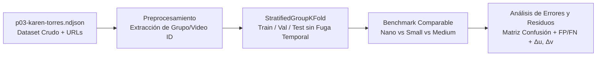

# Detección y Segmentación por Instancia de Uchuvas (*Physalis peruviana*) · Corte 2

Repositorio del bloque de percepción visual para la detección y segmentación de uchuvas en tres estados fenotípicos visuales (**pintona**, **madura** y **sobremadura**), articulado con el proyecto de captura aérea con dron DJI Neo.

---

## 🔄 1. Diagrama de Flujo del Pipeline Reproducible

---

## 🛡️ 2. Validación Adecuada: Estratificada por Grupos/Unidades de Captura

El dataset `P03 Karen Torres` contiene fotografías individuales y secuencias de fotogramas extraídos de videos, incluyendo fotogramas negativos de control (solo follaje). Para evitar **fuga de datos (*data leakage*)** entre fotogramas consecutivos, se aplicó `StratifiedGroupKFold` agrupando por `group_id`.

| split   |   Imagenes |   Grupos_Unicos |   Imgs_Fondo_Control |   Pintona |   Madura |   Sobremadura |   Total_Anotaciones |
|:--------|-----------:|----------------:|---------------------:|----------:|---------:|--------------:|--------------------:|
| train   |        204 |              43 |                   73 |       969 |      249 |            59 |                1277 |
| val     |          9 |               8 |                    2 |        39 |        8 |            22 |                  69 |
| test    |          6 |               2 |                    0 |        49 |        5 |             0 |                  54 |

---

## 📊 3. Resumen del Benchmark y Análisis de Errores

* **Residuos espaciales del centroide (Δu, Δv):** El error euclidiano medio entre el centroide predicho y el centroide real anotado fue de **34.81 px** (mediana = **25.76 px**, IoU medio = **0.828**), garantizando la estabilidad geométrica para la localización 2D/3D con marcadores ArUco.
* **Desglose cuantitativo de fallos:**

| error_type               |   count |
|:-------------------------|--------:|
| Falso_Negativo_Omision   |      75 |
| Falso_Positivo_Follaje   |      32 |
| Clase_Confundida         |      11 |
| Falsa_Alarma_Frame_Vacio |       7 |

---

## 🤖 4. Bitácora de Uso de Inteligencia Artificial

| Fecha | Herramienta de IA | Propósito / Consulta | Verificación humana realizada |
| :--- | :--- | :--- | :--- |
| 2026-10-08 a 2026-10-14 | Ultralytics Hub | Etiquetado asistido de máscaras poligonales. | Revisión y ajuste manual de contornos en las imágenes de campo. |
| 2026-10-15 | Gemini (Google AI) | Generación del pipeline `StratifiedGroupKFold`, benchmark y script de análisis espacial. | Ejecución en Colab con GPU, auditoría de tablas y generación de reportes. |